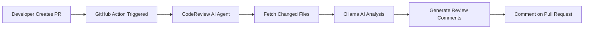

# 🤖 CodeReview AI Agent

An AI-powered GitHub Pull Request reviewer built with .NET and Ollama. The agent automatically analyzes Pull Request code changes, identifies security vulnerabilities, coding issues, and best-practice violations, then posts AI-generated review comments directly on GitHub PRs.

---

## 🚀 Tech Stack

<p align="center">


</p>

<p align="center">


</p>

---

## ✨ Features

- 🔍 Automated Pull Request Code Reviews
- 🤖 AI-Powered Code Analysis using Ollama
- 🔐 Detect Hardcoded Passwords & Secrets
- 💬 Automatic GitHub PR Comments
- ⚡ GitHub Actions Integration
- 🧠 Local LLM Support
- 🚀 No External AI API Required
- 📊 Code Quality Recommendations
- 🛡️ Security Vulnerability Detection

---

## 📂 Project Structure

```text
CodeReview-AI-Agent
│
├── Controllers
│   └── ReviewController.cs
│
├── Services
│   ├── GitHubService.cs
│   ├── OllamaService.cs
│   └── CodeReviewService.cs
│
├── Models
│   ├── PullRequestRequest.cs
│   └── ReviewResponse.cs
│
├── Program.cs
├── appsettings.json
└── README.md
```

---

## ⚙️ How It Works



---

## 🧠 AI Integration

The project uses **Ollama** running locally with **Llama 3.2** to perform intelligent code analysis.

```bash
ollama run llama3.2:3b
```

Default Ollama Endpoint:

```text
http://localhost:11434
```

---

## 🚀 Installation

Clone Repository

```bash
git clone https://github.com/your-username/CodeReview-AI-Agent.git
```

Navigate to Project

```bash
cd CodeReview-AI-Agent
```

Restore Packages

```bash
dotnet restore
```

Run Application

```bash
dotnet run
```

---

## 🔐 Example Security Detection

### Input Code

```csharp
var password = "admin123";
Console.WriteLine(password);
```

### AI Review Result

```text
🚨 Security Issue Detected

Hardcoded password found.
Move sensitive credentials to secure configuration or environment variables.
```

---

## 🔄 GitHub Actions Workflow

```yaml
name: AI Code Review

on:
  pull_request:
    types:
      - opened
      - synchronize
      - reopened

jobs:
  ai-review:
    runs-on: self-hosted

    steps:
      - uses: actions/checkout@v4

      - name: Call AI Review API
        run: |
          curl -X POST http://localhost:5000/api/review \
          -H "Content-Type: application/json" \
          -d '{
            "owner":"${{ github.repository_owner }}",
            "repo":"${{ github.event.repository.name }}",
            "pullNumber":"${{ github.event.pull_request.number }}"
          }'
```

---

## 📌 API Endpoint

### Review Pull Request

```http
POST /api/review
```

Request

```json
{
  "owner": "organization-name",
  "repo": "repository-name",
  "pullNumber": 1
}
```

Response

```json
{
  "review": "Hardcoded password detected."
}
```

---

## 🎯 Use Cases

- AI-Based Pull Request Reviews
- Secure Code Analysis
- DevSecOps Automation
- Team Code Review Assistance
- CI/CD Quality Gates
- Open Source Contribution Reviews

---

## 📈 Future Enhancements

- Multi-Model AI Support
- Inline GitHub Review Comments
- Severity-Based Reporting
- Multi-Language Code Analysis
- Dashboard & Analytics
- Azure DevOps Integration

---

## 👨‍💻 Author

### Sai Mallavarapu

.NET Full Stack Developer

<p>


</p>

---

## ⭐ Support

If you found this project useful, consider giving it a ⭐ on GitHub.

---

## 📄 License

This project is intended for educational, research, and internal development purposes.
